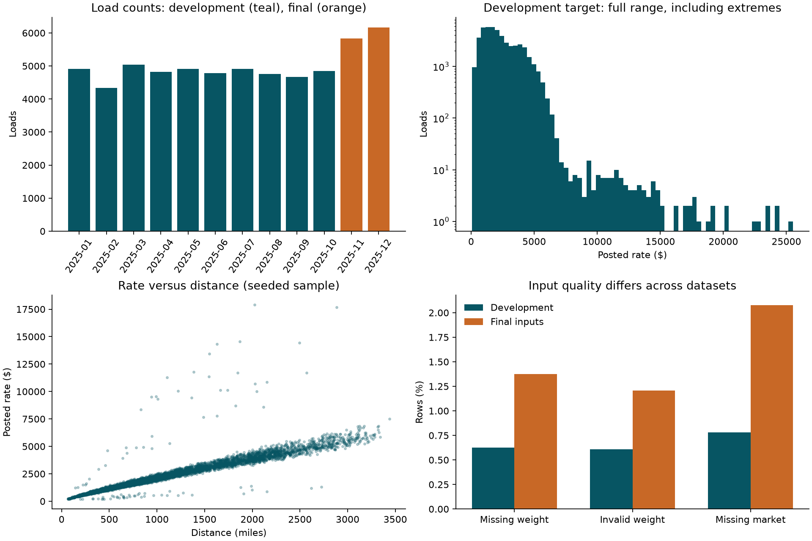
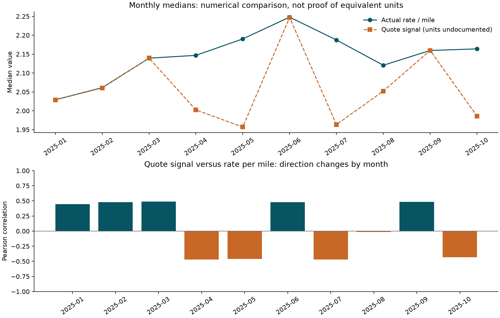

# Exploratory analysis and data-quality audit

Generated by `python -m freight.explore`. Inputs are read-only. Exact input
SHA-256 hashes and machine-readable results are in `audit.json`.

## Data and prediction horizon

Development: **48,000** loads, 2025-01-01 through 2025-10-31.
Final inputs: **12,000** loads, 2025-11-01 through 2025-12-31.
The final inputs have no labels. Their feature distributions are inspected only
to check inference compatibility; they cannot provide accuracy measurements.
All template IDs match; development and final IDs are disjoint.



## Quality and cleaning policy

| dataset | rows | missing_weight | nonpositive_weight | missing_market |
| --- | --- | --- | --- | --- |
| Development | 48000 | 300 | 292 | 374 |
| Final inputs | 12000 | 165 | 145 | 249 |

Both main datasets have unique IDs and no duplicate feature rows. Coordinates
are within valid latitude/longitude bounds and consistent per city within each
dataset; this does not prove their real-world geographic accuracy. No external
geocoding or coordinate replacement has been performed.

Treat nonpositive weights as unknown, with separate missing/invalid indicators.
Do not turn negative weights positive without evidence. The stateless cleaner
leaves missing values for a later model or a fold-fitted imputer. It removes
`load_id` and `posted_rate` from the feature frame. Market-index missingness also
gets an indicator. Do not drop final prediction rows.

Development weights missing after this cleaning: **592**.

## Target and equipment

Median rate: **$2,030.76**; observed range:
**$57.22-$25,533.00**.
Pearson correlation of distance with posted rate: **0.9085**.
There are **260** rates above the exploratory
upper IQR fence ($6,449.54). These are candidates for investigation, not
confirmed errors. Retain labels initially; compare robust objectives and inspect
residuals rather than deleting expensive loads. Any learned clipping or outlier
threshold must use the training fold only, never validation labels.

| equipment | rows | median_rate | median_rate_per_mile |
| --- | --- | --- | --- |
| Dry Van | 27202 | 1953.0350 | 2.0462 |
| Flatbed | 8753 | 2076.8100 | 2.2197 |
| Reefer | 12045 | 2196.6700 | 2.3115 |

## Signal stability and leakage uncertainty



| month | rows | median_rate_per_mile | median_quote | quote_rpm_correlation | median_market |
| --- | --- | --- | --- | --- | --- |
| 2025-01 | 4918 | 2.0292 | 2.0287 | 0.4467 | 0.9329 |
| 2025-02 | 4337 | 2.0611 | 2.0604 | 0.4790 | 0.9931 |
| 2025-03 | 5036 | 2.1393 | 2.1396 | 0.4858 | 1.0649 |
| 2025-04 | 4819 | 2.1467 | 2.0023 | -0.4717 | 1.2071 |
| 2025-05 | 4913 | 2.1902 | 1.9569 | -0.4592 | 1.3040 |
| 2025-06 | 4783 | 2.2479 | 2.2470 | 0.4766 | 1.2751 |
| 2025-07 | 4912 | 2.1874 | 1.9634 | -0.4683 | 1.2121 |
| 2025-08 | 4759 | 2.1205 | 2.0522 | -0.0136 | 0.9823 |
| 2025-09 | 4670 | 2.1596 | 2.1597 | 0.4814 | 0.8878 |
| 2025-10 | 4853 | 2.1638 | 1.9858 | -0.4340 | 0.9582 |

Quote-signal correlation with rate per mile changes sign across months. Overall
correlation is only **0.0493** and masks these
changes. This is evidence of an unstable observed relationship, not proof of
target leakage. Signal generation and availability at quote time are undocumented.
Compare models with and without quote signal and market index on chronological
backtests. Do not create month-specific sign corrections using holdout labels.
No yearly seasonal effect can be reliably estimated from this partial single year.

## New locations and lanes

Final pickup cities absent from training: Allentown, Charlotte, Chicago, Jackson, Knoxville, Laredo, Norfolk, San Diego.
Final delivery cities absent from training: Allentown, Charlotte, Chicago, Jackson, Knoxville, Laredo, Norfolk, San Diego.
Final rows with either city unseen: **1,447**.
Final rows with an unseen directed pickup-delivery lane: **1,461**.
Use features and encoders that support unfamiliar locations. In addition to time
backtests, simulate location holdouts using labeled data; temporal backtests alone
may not represent this shift. Unseen counts for each proposed temporal split are
recorded in `audit.json`.

## Proposed validation protocol

| name | train_end | validation_start | validation_end | train_rows | validation_rows |
| --- | --- | --- | --- | --- | --- |
| development_1 | 2025-04-30 | 2025-05-01 | 2025-06-30 | 19110 | 9696 |
| development_2 | 2025-06-30 | 2025-07-01 | 2025-08-31 | 28806 | 9671 |
| final_check | 2025-08-31 | 2025-09-01 | 2025-10-31 | 38477 | 9523 |

Use expanding training windows and two-month validation horizons. Use the first
two windows for model/feature decisions. Reserve September-October for a final
performance check after those decisions; do not tune repeatedly against it.
Dataset-level exploratory summaries include all development months, but no model
performance on this final check has been inspected. Fit preprocessing, encoders,
imputers, and any target transformations within each training fold. Use MAE and
RMSE in dollars, plus R-squared, and report errors by month, equipment, distance,
missingness, and unseen locations. The employer's hidden metric is unspecified.
After selection and the final check, refit on all eligible labeled loads.

## December chart inference

The 31 fixed rows omit: pickup_lat, pickup_lon, delivery_lat, delivery_lon, market_index, quote_signal.
Compare a model using only chart-available features against a full-feature model
with an explicitly validated missing-feature path. A city-coordinate mapping,
if used, must be learned from training rows only. Future quote signals and market
indices cannot be recovered from labels or fabricated as observed values. Validate
the reduced-input path by masking those features on chronological holdouts.
Use the supplied scorer to generate the required final chart after predictions.

## Reproduce

```powershell
python -m freight.explore
python -m unittest discover -s tests -v
```

This checkpoint performs analysis and validates cleaning/splitting utilities.
No submission predictions or final model have been generated yet.
