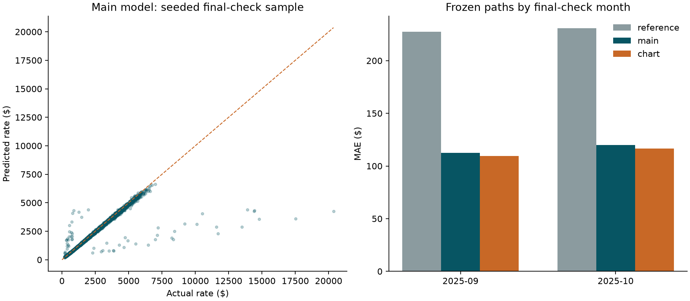

# Frozen September-October evaluation

The policy in `model_policy.json` and its rationale in `MODEL_DECISIONS.md` were
recorded before evaluating this window. Experiment ID:
`51b63d84ed62434037462ad9b1c019c71db9389f89486b4fb248a6c5b9cb8399`. Source, configuration, implementation, environment,
and prediction hashes are recorded in `manifest.json`.

## Results

| role | model | rows | mae | rmse | r2 |
| --- | --- | --- | --- | --- | --- |
| reference | equipment_rate_per_mile | 9523 | 229.0966 | 670.6600 | 0.8069 |
| main | catboost_full_mae | 9523 | 116.1888 | 636.2410 | 0.8262 |
| chart | catboost_chart_mae | 9523 | 113.0905 | 635.1445 | 0.8268 |

Training: **38,477** loads from 2025-01-01 through
2025-08-31. Evaluation: **9,523** later loads from
2025-09-01 through 2025-10-31.
The main model's MAE reduction versus the predeclared reference is
**49.3%**. These are out-of-time internal metrics, not Spotter's hidden
submission scores. The employer's evaluation metric is unspecified.

## Monthly results

| role | model | segment | rows | mae | rmse | r2 |
| --- | --- | --- | --- | --- | --- | --- |
| reference | equipment_rate_per_mile | 2025-09 | 4670 | 227.3228 | 657.0658 | 0.8139 |
| reference | equipment_rate_per_mile | 2025-10 | 4853 | 230.8034 | 683.4863 | 0.8001 |
| main | catboost_full_mae | 2025-09 | 4670 | 112.3480 | 619.2617 | 0.8347 |
| main | catboost_full_mae | 2025-10 | 4853 | 119.8848 | 652.1628 | 0.8180 |
| chart | catboost_chart_mae | 2025-09 | 4670 | 109.4049 | 618.1063 | 0.8354 |
| chart | catboost_chart_mae | 2025-10 | 4853 | 116.6372 | 651.1193 | 0.8185 |

## Method and interpretation

- Main: full-feature CatBoost MAE model for all loads, including unseen cities.
- Chart: separately trained CatBoost MAE model using only the six December input
  fields. All six unavailable features were removed before inference here;
  no future market/quote signals or coordinates were supplied to that model.
- Reference: training median rate per mile by equipment, with a global fallback.
- All model fits used January-August rows only, fixed parameters, and no early
  stopping against this window. Every evaluation load is included. No target
  outliers were removed and no post-evaluation adjustments were made.
- `segment_metrics.csv` includes equipment, distance, missingness, month, and
  city novelty. This temporal window has no unseen cities; geographic risk is
  assessed separately in the development city stress test.
- `feature_importance.csv` contains training-derived prediction-value-change
  importance, not holdout permutation importance or causal evidence. Correlated
  features can share or dilute these values. It is descriptive and does not
  drive a new feature selection round.

## Frozen decision and next step

Retain the predeclared main and chart models and their parameters regardless of
these results. Refit them on all 48,000 eligible labeled loads, generate the
12,000 final predictions and 31 fixed December predictions, and validate them
with the unchanged supplied scorer. Those refitted models have different
training data; the metrics above describe the January-August fits only.

Re-running `python -m freight.final_check` with the same experiment reproduces
this evaluation; it does not create another independent test set. The command
refuses to overwrite an existing report from a different experiment.
