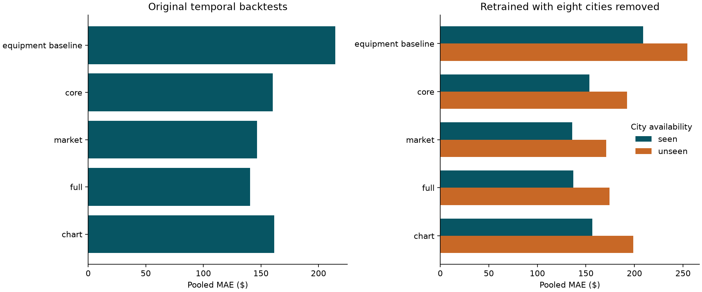

# Geographic robustness and development residuals

Run `python -m freight.robustness` after `python -m freight.benchmark`.
September-October remains excluded from fitting, scoring, and model selection.

## Target-independent city holdout

Eight cities were selected by stable seeded hashes using only the cities present
in January-April training, without inspecting their labels or validation errors:
**Boston, Philadelphia, Dallas, Fresno, Buffalo, Corpus Christi, El Paso, Hartford**. All loads involving any selected city, at either pickup
or delivery, were removed from each training fold. May-June and July-August
validation loads were left intact. The models were retrained from scratch.

| fold | original_train_rows | purged_train_rows | validation_rows | unseen_city_rows |
| --- | --- | --- | --- | --- |
| development_1 | 19110 | 14571 | 9696 | 2200 |
| development_2 | 28806 | 22067 | 9671 | 2203 |

This simulates a city being unavailable in training, including both route
directions. It also reduces the training size and changes the city mix, so it is
a stress test rather than an unbiased estimate of error on Spotter's eight new
cities. It is one fixed city subset, not a confidence interval. Seen/unseen
labels below refer to availability in the purged training fold.

| model | segment | rows | mae | rmse | r2 |
| --- | --- | --- | --- | --- | --- |
| catboost_market_mae | seen | 14964 | 135.8004 | 606.8463 | 0.8261 |
| catboost_full_mae | seen | 14964 | 137.0571 | 609.2424 | 0.8247 |
| catboost_core_mae | seen | 14964 | 153.4204 | 611.7009 | 0.8233 |
| catboost_chart_mae | seen | 14964 | 156.4437 | 612.9869 | 0.8226 |
| equipment_rate_per_mile | seen | 14964 | 208.8034 | 633.0473 | 0.8107 |
| catboost_market_mae | unseen | 4403 | 170.8115 | 717.3284 | 0.8127 |
| catboost_full_mae | unseen | 4403 | 174.3536 | 720.0505 | 0.8113 |
| catboost_core_mae | unseen | 4403 | 192.2277 | 722.5833 | 0.8100 |
| catboost_chart_mae | unseen | 4403 | 198.7594 | 724.3147 | 0.8090 |
| equipment_rate_per_mile | unseen | 4403 | 254.3317 | 752.7870 | 0.7937 |

The lowest pooled unseen-city MAE in this stress test is
**$170.81** from **catboost_market_mae**. Consult
`location_fold_metrics.csv` for each period rather than selecting only from a
pooled score. Do not combine the stress scores with temporal scores as though
they were predictions from the same training population.

## Original temporal residuals

These diagnostics reuse the original benchmark's out-of-time predictions, not
the city-purged models. Prediction IDs, labels, source hashes, and aggregate scores
are checked before analysis. No final-input labels are used.

| model | mae | rmse | bias | median_absolute_error | p90_absolute_error | largest_1pct_squared_error_share |
| --- | --- | --- | --- | --- | --- | --- |
| catboost_full_mae | 140.7030 | 635.2020 | -40.0272 | 58.2945 | 226.4284 | 0.9523 |
| catboost_market_mae | 146.6700 | 634.0013 | -9.9952 | 68.9735 | 226.5041 | 0.9524 |
| catboost_core_mae | 160.3659 | 638.1137 | -2.1211 | 78.3040 | 261.2832 | 0.9397 |
| catboost_chart_mae | 161.5545 | 638.3546 | -5.7890 | 80.1615 | 263.0911 | 0.9395 |
| catboost_core_rmse | 198.0229 | 671.4186 | 40.3571 | 92.3421 | 337.1109 | 0.8752 |
| ridge_core_rate_per_mile | 213.1825 | 651.3480 | 79.5023 | 117.0725 | 403.1880 | 0.8794 |
| equipment_rate_per_mile | 214.4471 | 658.5362 | -24.7457 | 127.2127 | 356.6914 | 0.8809 |
| median_rate | 1152.0660 | 1574.7938 | -411.1134 | 928.8200 | 2418.6040 | 0.2248 |

For the best temporal-MAE candidate (**catboost_full_mae**), median absolute error is
**$58.29**, and the largest 1% of errors account for
**95.2%** of total squared error.
The full RMSE remains **$635.20**; none of these loads were deleted or
excluded from headline scores. The 25 largest errors are listed in
`largest_development_errors.csv` for inspection. Their size alone does not
establish that their labels are wrong.

`rate_per_mile_bands.csv` separates loads below, within, and above the training
fold's 1st/99th percentile rates per mile. Thresholds are fitted to training
labels only, then used for labeled retrospective diagnostics. These bands must
never be used as inference features or a reason to omit difficult validation
loads. All eight original candidate models are included in the residual audit.

## Model decision status

The temporal MAE leader remains the full-feature CatBoost candidate. MAE and
RMSE rank the market-only and full-signal variants differently, and signal
relationships vary by period. Geographic stress results add a separate check;
they do not resolve the unknown future signal regime. The chart-only candidate
has a validated path requiring exactly the supplied December feature availability.

Next, lock the prediction policy and hyperparameters using development evidence,
evaluate the reserved September-October window once, then fit on all labeled
loads and generate the final files. This checkpoint does not train a submission
model or create submission predictions.
